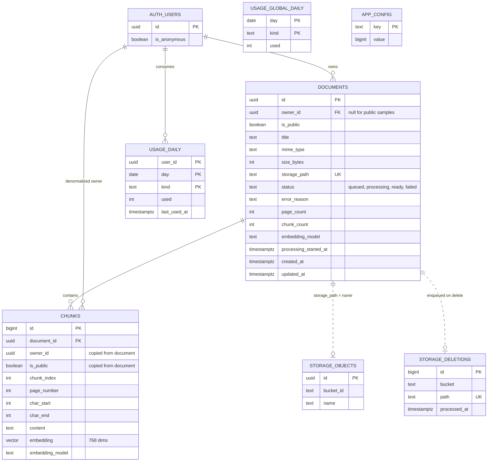

# Document Q&A: Data Model

Companion to `REQUIREMENTS.md` and `ARCHITECTURE.md`. This covers the Postgres schema, Row Level Security, storage rules, indexes, lifecycle, migrations, seed data, and security tests.

**How to read the SQL in this document.** Every SQL block is tagged with the migration file it belongs to (`-- migration: 0003_documents.sql`). Blocks with the same tag are concatenated into that file **in the order they appear**. Section 6 lists the files in run order. I did not run any of this SQL against a real Supabase instance, so treat it as a carefully reviewed draft: run the migrations locally and then run the tests in section 7 before trusting it.

---

## 0. Decisions and Things You Must Enable or Verify

### Decisions made here (change them before ingesting any data)

| Decision                       | Value                                                                              | Why                                                                                                                                                                                                                                                                                                             |
| ------------------------------ | ---------------------------------------------------------------------------------- | --------------------------------------------------------------------------------------------------------------------------------------------------------------------------------------------------------------------------------------------------------------------------------------------------------------- |
| Embedding dimension            | `vector(768)`                                                                      | A middle size that keeps the 500 MB database comfortable. **🔎 VERIFY** that your chosen embedding model can output 768 dimensions (many models let you pick a reduced size). If not, change the number in migration 0004 **before** the first ingest, because changing it later means re-embedding everything. |
| Vector index                   | **None** in the MVP                                                                | Per-user data is tiny; exact search is correct and fast. Optional HNSW migration is in section 4.                                                                                                                                                                                                               |
| Statuses and error codes       | `text` + `CHECK`, not Postgres enums                                               | Easier to evolve with a migration.                                                                                                                                                                                                                                                                              |
| Who writes chunks and statuses | **Service role only**                                                              | Users can never forge "ready" documents or fake chunks.                                                                                                                                                                                                                                                         |
| Who creates document rows      | The signed-in user (column-restricted)                                             | Matches the architecture: row first, upload second, ingest third.                                                                                                                                                                                                                                               |
| Caps and limits                | Rows in `app_config`                                                               | Change them from the SQL editor without a redeploy.                                                                                                                                                                                                                                                             |
| Text/Markdown "pages"          | **Virtual pages** of fixed size (suggest ~4,000 characters, defined in app config) | `.txt`/`.md` have no pages, but every chunk needs a `page_number` for a uniform citation model. With a 30-page limit that means roughly 120,000 characters max per text file.                                                                                                                                   |

### Features and extensions to enable

| Item                              | How                                                                                                                  | Notes                                                                                                                                                                 |
| --------------------------------- | -------------------------------------------------------------------------------------------------------------------- | --------------------------------------------------------------------------------------------------------------------------------------------------------------------- |
| **pgvector**                      | Dashboard → Database → Extensions, or `create extension vector with schema extensions;` (included in migration 0001) | 🔎 VERIFY the installed version (matters only if you add HNSW later).                                                                                                 |
| **Anonymous sign-ins**            | Dashboard → Authentication → Sign In / Providers → enable anonymous sign-ins                                         | Required for demo mode. Anonymous users get the `authenticated` Postgres role plus an `is_anonymous` claim in their JWT. 🔎 VERIFY the claim name in a decoded token. |
| **CAPTCHA**                       | Dashboard → Authentication → Attack Protection → enable Turnstile (or hCaptcha)                                      | Protects anonymous sign-in from bots.                                                                                                                                 |
| `auth.users.is_anonymous` column  | Exists in current Supabase Auth                                                                                      | Used by the usage functions. 🔎 VERIFY on your project.                                                                                                               |
| **Storage bucket**                | Created by migration 0007                                                                                            | 🔎 VERIFY the `storage.buckets` columns (`file_size_limit`, `allowed_mime_types`) in your version.                                                                    |
| **pg_cron** (optional)            | Dashboard → Database → Extensions                                                                                    | Not used. Scheduling is an external cron plus GitHub Actions (Task 5.6).                                                                                             |
| **Exposed schemas**               | Dashboard → API settings                                                                                             | `public` is exposed (normal). **Do not expose `private`**; it holds trigger and helper functions.                                                                     |
| **Default grants**                | Explicit `GRANT`/`REVOKE` in every migration                                                                         | Supabase has changed default Data API grants over time (**🔎 VERIFY**); being explicit means the migrations behave the same regardless.                               |
| Deleting from `auth.users` in SQL | Used by the anonymous cleanup function                                                                               | 🔎 VERIFY it works from a `SECURITY DEFINER` function on your project; if not, delete via the Admin API instead.                                                      |

### Not used on purpose

- **Prisma** (see `ARCHITECTURE.md`): types come from `supabase gen types typescript`.
- **A `profiles` table**: nothing in the MVP needs one. Add it when you need display names.
- **A questions/answers log table**: postponed. Add later if you want feedback or analytics.

---

## 1. Entities

| Entity                               | Represents                                                                   | Relationships                                                                                  |
| ------------------------------------ | ---------------------------------------------------------------------------- | ---------------------------------------------------------------------------------------------- |
| `auth.users` (Supabase-managed)      | A person: permanent or anonymous demo session                                | Owns documents; has usage counters                                                             |
| `public.documents`                   | One uploaded file (or one public sample) with its processing status          | Belongs to a user, or to nobody if it's a public sample. Has many chunks                       |
| `public.chunks`                      | One retrievable passage of a document: page, offsets, text, embedding        | Belongs to a document. Carries a **denormalized copy** of the document's owner and public flag |
| `public.usage_daily`                 | Per-user, per-UTC-day counters by kind (`question`, `ingest`)                | Belongs to a user                                                                              |
| `public.usage_global_daily`          | App-wide per-day counters (the kill-switch budget)                           | None                                                                                           |
| `public.app_config`                  | Tunable limits (doc caps, daily caps, cooldowns)                             | None                                                                                           |
| `public.storage_deletions`           | Outbox of storage files that must be removed after a document row disappears | Logical link to a document via path (no FK, because the document is gone by then)              |
| `storage.objects` (Supabase-managed) | The files themselves                                                         | Logical link: `documents.storage_path = objects.name`                                          |



---

## 2. Schema

### 2.1 Foundations: extension, private schema, helpers

```sql
-- migration: 0001_extensions_and_helpers.sql

-- pgvector lives in the "extensions" schema on Supabase.
create extension if not exists vector with schema extensions;

-- Helper and trigger functions live in "private": never exposed through the API,
-- and unreachable by anon/authenticated roles.
create schema if not exists private;
revoke all on schema private from public, anon, authenticated;

create or replace function private.touch_updated_at()
returns trigger
language plpgsql
set search_path = ''
as $$
begin
  new.updated_at := now();
  return new;
end;
$$;
```

### 2.2 Config and the storage-deletion outbox

```sql
-- migration: 0002_config_and_outbox.sql

create table public.app_config (
  key         text primary key check (key ~ '^[a-z0-9_]+$'),
  value       bigint not null check (value >= 0),
  description text not null,
  updated_at  timestamptz not null default now()
);

create trigger app_config_touch
  before update on public.app_config
  for each row execute function private.touch_updated_at();

insert into public.app_config (key, value, description) values
  ('max_docs_per_user',        10,        'Maximum documents one user may own'),
  ('storage_budget_bytes',     209715200, 'Global budget for user-uploaded bytes (200 MB). Set BELOW your plan''s storage cap.'),
  ('limit_user_question',      20,        'Questions per signed-in user per UTC day'),
  ('limit_anon_question',      10,        'Questions per anonymous demo user per UTC day'),
  ('limit_global_question',    200,       'PLACEHOLDER: set from your real provider limits (see ARCHITECTURE.md capacity math)'),
  ('limit_user_ingest',        10,        'Ingestions per signed-in user per UTC day'),
  ('limit_anon_ingest',        0,         'Anonymous users cannot ingest'),
  ('limit_global_ingest',      40,        'PLACEHOLDER: ingestions per UTC day across the app'),
  ('cooldown_ms_question',     2000,      'Minimum milliseconds between two questions from one user'),
  ('stale_processing_minutes', 10,        'A document stuck in processing longer than this may be re-claimed')
on conflict (key) do nothing;

-- Fails loudly if a key is missing: a missing limit must never silently mean "unlimited".
create or replace function private.cfg(p_key text)
returns bigint
language plpgsql
stable
security definer
set search_path = ''
as $$
declare
  v bigint;
begin
  select c.value into v from public.app_config c where c.key = p_key;
  if not found then
    raise exception 'missing app_config key: %', p_key;
  end if;
  return v;
end;
$$;

-- Outbox: when a document row is deleted (by anyone, including cascades),
-- its storage path is recorded here so a server job can delete the file via the Storage API.
create table public.storage_deletions (
  id           bigint generated always as identity primary key,
  bucket       text not null default 'documents',
  path         text not null,
  attempts     integer not null default 0,
  last_error   text,
  created_at   timestamptz not null default now(),
  processed_at timestamptz,
  unique (bucket, path)
);

create index storage_deletions_pending_idx
  on public.storage_deletions (created_at)
  where processed_at is null;
```

### 2.3 `documents`

```sql
-- migration: 0003_documents.sql

create table public.documents (
  id                    uuid primary key default gen_random_uuid(),
  owner_id              uuid references auth.users (id) on delete cascade,
  is_public             boolean not null default false,
  title                 text not null,
  original_filename     text not null,
  mime_type             text not null,
  size_bytes            integer not null,
  storage_path          text not null unique,
  status                text not null default 'queued',
  error_reason          text,
  page_count            integer,
  chunk_count           integer not null default 0,
  embedding_model       text,
  pipeline_version      smallint not null default 1,
  processing_started_at timestamptz,
  created_at            timestamptz not null default now(),
  updated_at            timestamptz not null default now(),

  -- A document is either a private user document (has an owner) or a public sample (has none).
  constraint documents_owner_xor_public
    check ((is_public and owner_id is null) or (not is_public and owner_id is not null)),

  constraint documents_title_shape
    check (char_length(title) between 1 and 200 and title !~ '[[:cntrl:]]'),
  constraint documents_filename_shape
    check (char_length(original_filename) between 1 and 255 and original_filename !~ '[[:cntrl:]]'),
  constraint documents_mime_allowed
    check (mime_type in ('application/pdf', 'text/plain', 'text/markdown')),
  constraint documents_size_limit
    check (size_bytes between 1 and 5242880),                       -- 5 MB
  constraint documents_status_allowed
    check (status in ('queued', 'processing', 'ready', 'failed')),
  constraint documents_error_reason_matches_status
    check ((status = 'failed') = (error_reason is not null)),
  constraint documents_error_reason_allowed
    check (error_reason is null or error_reason in (
      'scanned_pdf', 'too_many_pages', 'file_too_large', 'unsupported_type',
      'corrupt_file', 'encrypted_file', 'empty_document',
      'provider_unavailable', 'internal_error')),
  constraint documents_page_count_limit
    check (page_count is null or page_count between 1 and 30),
  constraint documents_ready_is_complete
    check (status <> 'ready'
           or (page_count is not null and chunk_count > 0 and embedding_model is not null)),
  constraint documents_processing_has_timestamp
    check (status <> 'processing' or processing_started_at is not null),

  -- Storage path must have exactly this shape, which also blocks path traversal:
  --   private:  <owner_id>/<document_id>/<safe filename>
  --   public:   samples/<safe filename>
  constraint documents_storage_path_shape
    check (
      (is_public and storage_path ~ '^samples/[A-Za-z0-9._-]{1,100}$')
      or
      (not is_public and storage_path ~ ('^' || owner_id::text || '/' || id::text || '/[A-Za-z0-9._-]{1,100}$'))
    )
);

-- Enforce per-user document cap and the global storage budget, race-free.
create or replace function private.documents_before_insert()
returns trigger
language plpgsql
security definer
set search_path = ''
as $$
declare
  v_count integer;
  v_total bigint;
begin
  if new.owner_id is null then
    return new;                                   -- public samples are seeded by an admin script
  end if;

  -- BEFORE triggers run before RLS checks. Without this guard, a forged owner_id would still reach
  -- the cap logic below and could reveal whether ANOTHER user is at their document limit.
  -- auth.uid() is NULL for the service role and admin scripts, so they are unaffected.
  if auth.uid() is not null and new.owner_id is distinct from auth.uid() then
    raise exception 'owner_mismatch' using errcode = '42501';
  end if;

  -- Serialize inserts per user so two parallel uploads can't both slip under the cap.
  perform pg_advisory_xact_lock(hashtextextended(new.owner_id::text, 0));
  select count(*) into v_count from public.documents d where d.owner_id = new.owner_id;
  if v_count >= private.cfg('max_docs_per_user') then
    raise exception 'document_limit_reached' using hint = 'Delete a document before uploading another.';
  end if;

  -- Serialize the global budget check (tiny scale, so a global lock is fine).
  perform pg_advisory_xact_lock(hashtextextended('global_storage_budget', 0));
  select coalesce(sum(d.size_bytes), 0) into v_total from public.documents d where not d.is_public;
  if v_total + new.size_bytes > private.cfg('storage_budget_bytes') then
    raise exception 'storage_budget_exhausted' using hint = 'Uploads are paused. Try the demo documents.';
  end if;

  return new;
end;
$$;

-- Ownership, visibility, path and type can never change after insert.
create or replace function private.documents_before_update()
returns trigger
language plpgsql
set search_path = ''
as $$
begin
  if new.id           is distinct from old.id
  or new.owner_id     is distinct from old.owner_id
  or new.is_public    is distinct from old.is_public
  or new.storage_path is distinct from old.storage_path
  or new.mime_type    is distinct from old.mime_type
  or new.size_bytes   is distinct from old.size_bytes then
    raise exception 'immutable_column' using hint = 'owner, visibility, path, type and size cannot change.';
  end if;
  new.updated_at := now();
  return new;
end;
$$;

-- After any delete (including cascades from account deletion), queue the file for removal.
create or replace function private.documents_after_delete()
returns trigger
language plpgsql
security definer
set search_path = ''
as $$
begin
  insert into public.storage_deletions (bucket, path)
  values ('documents', old.storage_path)
  on conflict (bucket, path) do nothing;
  return old;
end;
$$;

create trigger documents_bi_limits
  before insert on public.documents
  for each row execute function private.documents_before_insert();

create trigger documents_bu_guard
  before update on public.documents
  for each row execute function private.documents_before_update();

create trigger documents_ad_outbox
  after delete on public.documents
  for each row execute function private.documents_after_delete();

create index documents_owner_created_idx on public.documents (owner_id, created_at desc);
create index documents_public_idx         on public.documents (created_at) where is_public;
create index documents_processing_idx     on public.documents (processing_started_at) where status = 'processing';
create index documents_status_created_idx on public.documents (status, created_at) where status in ('queued', 'failed');
```

### 2.4 `chunks` and the retrieval function

```sql
-- migration: 0004_chunks_and_search.sql

create table public.chunks (
  id              bigint generated always as identity primary key,
  document_id     uuid not null references public.documents (id) on delete cascade,
  owner_id        uuid references auth.users (id) on delete cascade,   -- copied from the document by trigger
  is_public       boolean not null default false,                      -- copied from the document by trigger
  chunk_index     integer not null check (chunk_index >= 0),
  page_number     integer not null check (page_number between 1 and 30),
  char_start      integer not null check (char_start >= 0),
  char_end        integer not null,
  content         text not null check (char_length(content) between 1 and 4000),
  token_count     integer check (token_count > 0),
  embedding       extensions.vector(768) not null,
  embedding_model text not null,
  created_at      timestamptz not null default now(),

  unique (document_id, chunk_index),
  constraint chunks_offsets_ordered check (char_end > char_start),
  constraint chunks_owner_xor_public
    check ((is_public and owner_id is null) or (not is_public and owner_id is not null))
);

-- Whatever the caller supplies for owner_id/is_public is overwritten with the document's values.
-- Combined with the immutability trigger on documents, the copies can never drift.
create or replace function private.chunks_before_insert()
returns trigger
language plpgsql
security definer
set search_path = ''
as $$
declare
  v_owner  uuid;
  v_public boolean;
begin
  select d.owner_id, d.is_public into v_owner, v_public
  from public.documents d
  where d.id = new.document_id;

  if not found then
    raise exception 'document_not_found';
  end if;

  new.owner_id  := v_owner;
  new.is_public := v_public;
  return new;
end;
$$;

create trigger chunks_bi_copy_owner
  before insert on public.chunks
  for each row execute function private.chunks_before_insert();

create index chunks_owner_idx  on public.chunks (owner_id);
create index chunks_public_idx on public.chunks (document_id) where is_public;

-- Retrieval. SECURITY INVOKER is deliberate: it runs with the caller's permissions,
-- so RLS filters every row. Never make this SECURITY DEFINER.
create or replace function public.match_chunks(
  query_embedding   extensions.vector,
  p_embedding_model text,
  match_count       integer default 6,
  p_document_id     uuid    default null
)
returns table (
  chunk_id    bigint,
  doc_id      uuid,
  doc_title   text,
  page_number integer,
  char_start  integer,
  char_end    integer,
  content     text,
  similarity  double precision
)
language sql
stable
security invoker
set search_path = public, extensions
as $$
  select c.id,
         c.document_id,
         d.title,
         c.page_number,
         c.char_start,
         c.char_end,
         c.content,
         1 - (c.embedding <=> query_embedding) as similarity
  from public.chunks c
  join public.documents d on d.id = c.document_id
  where d.status = 'ready'
    and c.embedding_model = p_embedding_model
    and (p_document_id is null or c.document_id = p_document_id)
  order by c.embedding <=> query_embedding
  limit least(greatest(match_count, 1), 20);
$$;

revoke all on function public.match_chunks(extensions.vector, text, integer, uuid) from public, anon;
grant execute on function public.match_chunks(extensions.vector, text, integer, uuid) to authenticated;
```

### 2.5 Usage counters and limit functions

```sql
-- migration: 0005_usage.sql

create table public.usage_daily (
  user_id      uuid not null references auth.users (id) on delete cascade,
  day          date not null,
  kind         text not null check (kind in ('question', 'ingest')),
  used         integer not null default 0 check (used >= 0),
  last_used_at timestamptz not null default now(),
  primary key (user_id, day, kind)
);

create table public.usage_global_daily (
  day  date not null,
  kind text not null check (kind in ('question', 'ingest')),
  used integer not null default 0 check (used >= 0),
  primary key (day, kind)
);

-- Atomic "check and spend one unit". Call BEFORE any provider call.
-- Returns allowed=false with a reason: 'user_limit', 'cooldown', 'global_limit', 'not_allowed', 'unknown_user'.
create or replace function public.consume_usage(p_user_id uuid, p_kind text)
returns table (allowed boolean, reason text, used_today integer, daily_limit integer, resets_at timestamptz)
language plpgsql
security definer
set search_path = ''
as $$
declare
  v_day          date        := (now() at time zone 'utc')::date;
  v_reset        timestamptz := ((v_day + 1)::timestamp at time zone 'utc');
  v_is_anon      boolean;
  v_user_limit   integer;
  v_global_limit integer;
  v_cooldown     interval    := null;
  v_used         integer;
  v_global_used  integer;
begin
  if p_kind not in ('question', 'ingest') then
    raise exception 'unknown usage kind: %', p_kind;
  end if;

  select coalesce(u.is_anonymous, false) into v_is_anon from auth.users u where u.id = p_user_id;
  if not found then
    return query select false, 'unknown_user'::text, 0, 0, v_reset;
    return;
  end if;

  if v_is_anon then
    v_user_limit := private.cfg('limit_anon_' || p_kind)::integer;
  else
    v_user_limit := private.cfg('limit_user_' || p_kind)::integer;
  end if;
  v_global_limit := private.cfg('limit_global_' || p_kind)::integer;

  if p_kind = 'question' then
    v_cooldown := make_interval(secs => (private.cfg('cooldown_ms_question') / 1000.0)::double precision);
  end if;

  if v_user_limit <= 0 or v_global_limit <= 0 then
    return query select false, 'not_allowed'::text, 0, greatest(v_user_limit, 0), v_reset;
    return;
  end if;

  -- 1) Per-user counter. The WHERE on the conflict branch makes check+increment one atomic statement.
  insert into public.usage_daily as ud (user_id, day, kind, used, last_used_at)
  values (p_user_id, v_day, p_kind, 1, now())
  on conflict (user_id, day, kind) do update
    set used = ud.used + 1,
        last_used_at = now()
    where ud.used < v_user_limit
      and (v_cooldown is null or ud.last_used_at <= now() - v_cooldown)
  returning ud.used into v_used;

  if v_used is null then
    select ud.used into v_used
    from public.usage_daily ud
    where ud.user_id = p_user_id and ud.day = v_day and ud.kind = p_kind;

    return query select false,
                        (case when v_used >= v_user_limit then 'user_limit' else 'cooldown' end)::text,
                        v_used, v_user_limit, v_reset;
    return;
  end if;

  -- 2) Global counter (the kill switch). If it's exhausted, give the user's unit back.
  insert into public.usage_global_daily as g (day, kind, used)
  values (v_day, p_kind, 1)
  on conflict (day, kind) do update
    set used = g.used + 1
    where g.used < v_global_limit
  returning g.used into v_global_used;

  if v_global_used is null then
    update public.usage_daily ud
       set used = greatest(ud.used - 1, 0)
     where ud.user_id = p_user_id and ud.day = v_day and ud.kind = p_kind;

    return query select false, 'global_limit'::text, greatest(v_used - 1, 0), v_user_limit, v_reset;
    return;
  end if;

  return query select true, 'ok'::text, v_used, v_user_limit, v_reset;
end;
$$;

-- Give a unit back when the failure was ours (provider outage, etc.).
create or replace function public.refund_usage(p_user_id uuid, p_kind text)
returns void
language sql
security definer
set search_path = ''
as $$
  update public.usage_daily ud
     set used = greatest(ud.used - 1, 0)
   where ud.user_id = p_user_id
     and ud.kind = p_kind
     and ud.day = (now() at time zone 'utc')::date;

  update public.usage_global_daily g
     set used = greatest(g.used - 1, 0)
   where g.kind = p_kind
     and g.day = (now() at time zone 'utc')::date;
$$;
```

### 2.6 Ingestion state machine (server-only functions)

```sql
-- migration: 0006_ingestion_functions.sql

-- Atomically move a document into 'processing'. Returns false if someone else already has it
-- (or it's already ready). Also clears any half-written chunks from a previous attempt.
create or replace function public.claim_document_for_ingest(p_document_id uuid)
returns boolean
language plpgsql
security definer
set search_path = ''
as $$
declare
  v_claimed boolean := false;
begin
  update public.documents d
     set status = 'processing',
         processing_started_at = now(),
         error_reason = null,
         chunk_count = 0
   where d.id = p_document_id
     and (
           d.status in ('queued', 'failed')
        or (d.status = 'processing'
            and d.processing_started_at < now() - make_interval(mins => private.cfg('stale_processing_minutes')::integer))
     )
  returning true into v_claimed;

  if coalesce(v_claimed, false) then
    delete from public.chunks c where c.document_id = p_document_id;
  end if;

  return coalesce(v_claimed, false);
end;
$$;

-- Flip to 'ready' only if chunks were actually written with the expected model.
create or replace function public.finalize_ingestion(
  p_document_id      uuid,
  p_page_count       integer,
  p_embedding_model  text,
  p_pipeline_version smallint default 1
)
returns void
language plpgsql
security definer
set search_path = ''
as $$
declare
  v_chunks integer;
begin
  select count(*) into v_chunks from public.chunks c where c.document_id = p_document_id;
  if v_chunks = 0 then
    raise exception 'no_chunks_written';
  end if;

  if exists (select 1 from public.chunks c
             where c.document_id = p_document_id and c.embedding_model <> p_embedding_model) then
    raise exception 'embedding_model_mismatch';
  end if;

  update public.documents d
     set status = 'ready',
         page_count = p_page_count,
         chunk_count = v_chunks,
         embedding_model = p_embedding_model,
         pipeline_version = p_pipeline_version,
         processing_started_at = null
   where d.id = p_document_id
     and d.status = 'processing';

  if not found then
    raise exception 'document_not_processing';
  end if;
end;
$$;

create or replace function public.fail_ingestion(p_document_id uuid, p_reason text)
returns void
language plpgsql
security definer
set search_path = ''
as $$
begin
  delete from public.chunks c where c.document_id = p_document_id;

  update public.documents d
     set status = 'failed',
         error_reason = p_reason,
         processing_started_at = null,
         chunk_count = 0
   where d.id = p_document_id
     and d.status in ('queued', 'processing');
end;
$$;
```

> **Implemented in Task 1.6** as `supabase/migrations/20261102120000_ingestion_functions.sql` (label 0006: the SQL above plus the 0006 grants in §3.2, unchanged). The service layer (`features/ingestion/`) writes chunk batches as an upsert on `(document_id, chunk_index)`, so a repeated batch cannot duplicate rows. If `finalize_ingestion` raises `document_not_processing` (the document was re-claimed after the stale timeout), the run stops without calling `fail_ingestion`, because that function deletes the document's chunks and would remove the new owner's rows. The reasons written to `documents.error_reason` are the extraction codes plus `provider_unavailable`; anything else is `internal_error`.

### 2.7 Storage bucket

```sql
-- migration: 0007_storage.sql

insert into storage.buckets (id, name, public, file_size_limit, allowed_mime_types)
values ('documents', 'documents', false, 5242880,
        array['application/pdf', 'text/plain', 'text/markdown'])
on conflict (id) do update
  set public = false,
      file_size_limit = excluded.file_size_limit,
      allowed_mime_types = excluded.allowed_mime_types;
```

> **Heads-up on `.md` uploads:** browsers often report Markdown files as `application/octet-stream` or an empty type. The bucket's MIME allowlist would reject that. The upload code must set `contentType` explicitly (`text/markdown`) from the file extension, and ingestion must still verify the content server-side.

### 2.8 Maintenance functions

```sql
-- migration: 0008_maintenance.sql

-- Remove abandoned and long-failed documents. Deleting rows fires the outbox trigger,
-- so the files get cleaned up too.
create or replace function public.reap_documents(
  p_queued_age interval default '1 hour',
  p_failed_age interval default '7 days'
)
returns integer
language plpgsql
security definer
set search_path = ''
as $$
declare
  v_count integer;
begin
  with gone as (
    delete from public.documents d
     where d.is_public = false
       and (
             (d.status = 'queued' and d.created_at < now() - p_queued_age)
          or (d.status = 'failed' and d.updated_at < now() - p_failed_age)
       )
    returning 1
  )
  select count(*) into v_count from gone;
  return v_count;
end;
$$;

-- Anonymous demo users own nothing (they can't upload), so deleting them is safe.
create or replace function public.purge_stale_anonymous_users(p_older_than interval default '14 days')
returns integer
language plpgsql
security definer
set search_path = ''
as $$
declare
  v_count integer;
begin
  with gone as (
    delete from auth.users u
     where u.is_anonymous
       and u.created_at < now() - p_older_than
    returning 1
  )
  select count(*) into v_count from gone;
  return v_count;
end;
$$;

create or replace function public.purge_old_records(p_keep interval default '30 days')
returns integer
language plpgsql
security definer
set search_path = ''
as $$
declare
  v_usage  integer;
  v_global integer;
  v_outbox integer;
begin
  with gone as (
    delete from public.usage_daily
     where day < ((now() at time zone 'utc') - p_keep)::date
    returning 1
  )
  select count(*) into v_usage from gone;

  with gone as (
    delete from public.usage_global_daily
     where day < ((now() at time zone 'utc') - p_keep)::date
    returning 1
  )
  select count(*) into v_global from gone;

  with gone as (
    delete from public.storage_deletions
     where processed_at is not null and processed_at < now() - p_keep
    returning 1
  )
  select count(*) into v_outbox from gone;

  return v_usage + v_global + v_outbox;   -- rows removed, so the scheduled job can log a count (Task 5.6)
end;
$$;
-- Task 5.6: this function now returns the number of rows it removed (it returned void), so the scheduled
-- job can log a count. As shipped, the change is the separate migration
-- 20261111120000_purge_old_records_count.sql (drop and recreate, same grants).

-- Scheduling: .github/workflows/maintenance.yml (Task 5.6), started by an external cron and GitHub's schedule, not
-- pg_cron. The storage outbox needs the Storage API, and the service-role key stays in CI secrets.
```

### 2.9 Non-obvious choices explained

| Choice                                                                                       | Reason                                                                                                                                                                                                                                                                                                            |
| -------------------------------------------------------------------------------------------- | ----------------------------------------------------------------------------------------------------------------------------------------------------------------------------------------------------------------------------------------------------------------------------------------------------------------- |
| `documents.owner_id` is **nullable**                                                         | Public samples have no owner. This makes them immune to account deletion (no cascade reaches them) and makes `owner_id = auth.uid()` evaluate to NULL (never true) for them. A CHECK ties nullability to `is_public` so a row can never be both ownerless and private.                                            |
| `chunks.owner_id` and `is_public` **duplicated** from `documents`                            | RLS on `chunks` then needs no join. Joins inside policies run for every row and are a classic slowdown. A trigger fills the copies, and an immutability trigger on `documents` guarantees they never go stale.                                                                                                    |
| `chunks.id` is `bigint identity`, documents use `uuid`                                       | Documents' IDs appear in URLs and storage paths, and the client generates them (path must contain the ID). Chunks are numerous, server-created, and never guessed usefully, so the compact type wins.                                                                                                             |
| `status` as text + CHECK, with cross-column CHECKs                                           | The DB itself refuses impossible states (`ready` with zero chunks; `failed` without a reason; `processing` without a start time).                                                                                                                                                                                 |
| `error_reason` is a controlled vocabulary                                                    | The UI maps each code to a friendly message, and free text can't leak provider internals to users.                                                                                                                                                                                                                |
| `size_bytes` and `mime_type` are client-claimed                                              | They are **not trusted**. The bucket enforces real size and type limits, and ingestion re-validates from the actual bytes. The columns exist for fast UI and budget accounting.                                                                                                                                   |
| `char_start`/`char_end`                                                                      | Offsets into the **normalized text of that page**, used by the highlighter. If you change the normalization algorithm, bump `pipeline_version` so old documents can be found and re-ingested.                                                                                                                     |
| `timestamptz` everywhere; usage days are **UTC**                                             | Avoids timezone bugs; the UI can show "resets at 00:00 UTC".                                                                                                                                                                                                                                                      |
| `embedding_model` stored on every chunk **and** document                                     | Lets you swap models later and query only vectors from the current model.                                                                                                                                                                                                                                         |
| Usage as one table keyed by `(user, day, kind)`                                              | Adding a new limited action is a config change, not a schema change.                                                                                                                                                                                                                                              |
| Limits in `app_config`, fail-loud lookup                                                     | Adjust caps from the SQL editor; a typo'd key raises an error instead of disabling a limit.                                                                                                                                                                                                                       |
| Definer functions use `set search_path = ''` and fully qualified names                       | Prevents search-path hijacking, a known attack on `SECURITY DEFINER` functions.                                                                                                                                                                                                                                   |
| Ingestion is multi-step (claim → insert chunk batches → finalize), not one giant transaction | Sending ~900 embeddings in one RPC payload is heavy. Instead, chunks are invisible to search until `finalize_ingestion` verifies them and flips status to `ready`, and `match_chunks` only returns chunks of `ready` documents. A crash leaves a harmless `processing` row that gets re-claimed after 10 minutes. |

---

## 3. Access Rules

### 3.1 Rules in plain language

| Table / object                         | Read                                                                                                                                                                                                         | Insert                                                                                                                                                                                                                                                 | Update                                                                            | Delete                                                                                |
| -------------------------------------- | ------------------------------------------------------------------------------------------------------------------------------------------------------------------------------------------------------------ | ------------------------------------------------------------------------------------------------------------------------------------------------------------------------------------------------------------------------------------------------------ | --------------------------------------------------------------------------------- | ------------------------------------------------------------------------------------- |
| `documents`                            | Your own documents, plus public samples. Works for signed-in and anonymous demo sessions. Unauthenticated callers: nothing.                                                                                  | Signed-in **non-anonymous** users only, as themselves, in the initial `queued` state, and only the columns `id, owner_id, title, original_filename, mime_type, size_bytes, storage_path`. Capped at 10 docs per user and by the global storage budget. | **Nobody** from the client. Status changes happen only via server-only functions. | Your own documents only. Public samples can't be deleted by users.                    |
| `chunks`                               | Chunks of your own documents, plus public samples.                                                                                                                                                           | **Server only** (service role).                                                                                                                                                                                                                        | Nobody.                                                                           | Only via cascade when the parent document is deleted, or by server functions.         |
| `usage_daily`, `usage_global_daily`    | Nobody from the client.                                                                                                                                                                                      | Server only, through `consume_usage`.                                                                                                                                                                                                                  | Same.                                                                             | Server only (purge function).                                                         |
| `app_config`                           | Nobody from the client.                                                                                                                                                                                      | You, from the SQL editor or migrations.                                                                                                                                                                                                                | Same.                                                                             | Same.                                                                                 |
| `storage_deletions`                    | Nobody from the client.                                                                                                                                                                                      | Trigger only.                                                                                                                                                                                                                                          | Server job only.                                                                  | Server job only.                                                                      |
| `storage.objects` (bucket `documents`) | Files in **your own folder**, plus everything under `samples/`.                                                                                                                                              | Only into **your own folder**, only if you're not anonymous, and only at the exact path of a `queued` document row you own.                                                                                                                            | Nobody (no overwrites).                                                           | Nobody from the client; the server deletes via the Storage API with the service role. |
| RPC functions                          | `match_chunks`: signed-in users. Everything else (`consume_usage`, `refund_usage`, `claim_document_for_ingest`, `finalize_ingestion`, `fail_ingestion`, `reap_documents`, `purge_*`): **service role only**. |                                                                                                                                                                                                                                                        |                                                                                   |                                                                                       |

"Service role" means your Next.js server using the secret key, which bypasses RLS. It's the only caller that can write chunks or statuses.

### 3.2 Policies and grants

```sql
-- migration: 0003_documents.sql  (append after the table and triggers above)

alter table public.documents enable row level security;

-- Start from zero, then grant exactly what's needed.
revoke all on public.documents from anon, authenticated;
grant select on public.documents to authenticated;
grant delete on public.documents to authenticated;
-- Column-level insert grant: users cannot even NAME is_public, status, page_count, etc.
grant insert (id, owner_id, title, original_filename, mime_type, size_bytes, storage_path)
  on public.documents to authenticated;

create policy documents_select
  on public.documents for select to authenticated
  using ( is_public or owner_id = (select auth.uid()) );

create policy documents_insert_own
  on public.documents for insert to authenticated
  with check (
    owner_id = (select auth.uid())
    and is_public = false
    and status = 'queued'
  );

-- RESTRICTIVE: ANDed with every permissive insert policy, so no future policy can re-open it.
create policy documents_insert_not_anonymous
  on public.documents as restrictive for insert to authenticated
  with check ( coalesce(((select auth.jwt()) ->> 'is_anonymous')::boolean, false) = false );

create policy documents_delete_own
  on public.documents for delete to authenticated
  using ( owner_id = (select auth.uid()) );

-- No UPDATE policy and no UPDATE grant: documents are immutable to clients.
```

```sql
-- migration: 0004_chunks_and_search.sql  (append after the function above)

alter table public.chunks enable row level security;

revoke all on public.chunks from anon, authenticated;
grant select on public.chunks to authenticated;

create policy chunks_select
  on public.chunks for select to authenticated
  using ( is_public or owner_id = (select auth.uid()) );

-- No insert/update/delete policies or grants: only the service role (which bypasses RLS) writes chunks.
```

```sql
-- migration: 0002_config_and_outbox.sql  (append)

alter table public.app_config        enable row level security;
alter table public.storage_deletions enable row level security;

-- RLS on with NO policies = deny all for anon/authenticated. The revokes are defense in depth.
revoke all on public.app_config        from anon, authenticated;
revoke all on public.storage_deletions from anon, authenticated;
```

```sql
-- migration: 0005_usage.sql  (append)

alter table public.usage_daily        enable row level security;
alter table public.usage_global_daily enable row level security;

revoke all on public.usage_daily        from anon, authenticated;
revoke all on public.usage_global_daily from anon, authenticated;

-- Functions in "public" are executable by PUBLIC by default, and Supabase exposes them as /rpc endpoints.
-- Revoke explicitly, then grant to the service role only.
revoke all on function public.consume_usage(uuid, text) from public, anon, authenticated;
revoke all on function public.refund_usage(uuid, text)  from public, anon, authenticated;
grant execute on function public.consume_usage(uuid, text) to service_role;
grant execute on function public.refund_usage(uuid, text)  to service_role;
```

```sql
-- migration: 0006_ingestion_functions.sql  (append)

revoke all on function public.claim_document_for_ingest(uuid)                     from public, anon, authenticated;
revoke all on function public.finalize_ingestion(uuid, integer, text, smallint)  from public, anon, authenticated;
revoke all on function public.fail_ingestion(uuid, text)                          from public, anon, authenticated;

grant execute on function public.claim_document_for_ingest(uuid)                     to service_role;
grant execute on function public.finalize_ingestion(uuid, integer, text, smallint)  to service_role;
grant execute on function public.fail_ingestion(uuid, text)                          to service_role;
```

```sql
-- migration: 0007_storage.sql  (append after the bucket insert)

-- Read: your own folder, or the shared samples folder.
create policy documents_objects_select
  on storage.objects for select to authenticated
  using (
    bucket_id = 'documents'
    and (
      split_part(name, '/', 1) = 'samples'
      or split_part(name, '/', 1) = (select auth.uid())::text
    )
  );

-- Write: own folder only, never anonymous, and only at the exact path of a queued row you own.
-- This ties every uploaded byte to a document row that already passed the cap triggers.
create policy documents_objects_insert
  on storage.objects for insert to authenticated
  with check (
    bucket_id = 'documents'
    and coalesce(((select auth.jwt()) ->> 'is_anonymous')::boolean, false) = false
    and split_part(name, '/', 1) = (select auth.uid())::text
    and exists (
      select 1
      from public.documents d
      where d.owner_id = (select auth.uid())
        and d.storage_path = name           -- "name" resolves to storage.objects.name
        and d.status = 'queued'
    )
  );

-- No UPDATE or DELETE policies: no overwrites, no client-side deletes.
```

```sql
-- migration: 0008_maintenance.sql  (append)

revoke all on function public.reap_documents(interval, interval)       from public, anon, authenticated;
revoke all on function public.purge_stale_anonymous_users(interval)    from public, anon, authenticated;
revoke all on function public.purge_old_records(interval)              from public, anon, authenticated;

grant execute on function public.reap_documents(interval, interval)    to service_role;
grant execute on function public.purge_stale_anonymous_users(interval) to service_role;
grant execute on function public.purge_old_records(interval)           to service_role;
```

### 3.3 How each rule could be bypassed if written wrongly, and the prevention

| Rule                      | The bug                                                                | The exploit                                                                                          | Prevention here                                                                                                                                                                                                                                                                                                                                                 |
| ------------------------- | ---------------------------------------------------------------------- | ---------------------------------------------------------------------------------------------------- | --------------------------------------------------------------------------------------------------------------------------------------------------------------------------------------------------------------------------------------------------------------------------------------------------------------------------------------------------------------- |
| **Table has no RLS**      | Forgetting `enable row level security`                                 | Anyone with the public anon key reads the whole table through the API                                | RLS enabled on every table; test T17 fails if any `public` table lacks it.                                                                                                                                                                                                                                                                                      |
| **`documents` select**    | `using (true)` or no role scoping                                      | Every user reads every document                                                                      | Policy scoped `to authenticated` with `is_public or owner_id = uid`. `anon` has no grant at all.                                                                                                                                                                                                                                                                |
|                           | `owner_id is not distinct from auth.uid()`                             | When `auth.uid()` is NULL (no session), it matches every ownerless sample row                        | Uses plain `=`; NULL never equals NULL.                                                                                                                                                                                                                                                                                                                         |
|                           | Calling `auth.uid()` bare in the policy                                | Works, but re-evaluated per row (slow)                                                               | Wrapped as `(select auth.uid())` so Postgres evaluates it once per query.                                                                                                                                                                                                                                                                                       |
| **`documents` insert**    | Policy only checks `owner_id = uid`                                    | User inserts `status='ready'`, `is_public=true`, or a `storage_path` pointing at someone else's file | Column-level grant means those columns can't be named; policy also pins `is_public=false` and `status='queued'`; path-shape CHECK ties the path to `owner_id` and `id`. The insert trigger also rejects any `owner_id` that isn't the caller _before_ it reaches the cap logic, so a forged insert can't probe whether another user is at their document limit. |
|                           | Counting existing docs inside the policy                               | Two parallel inserts both see "9 documents" and both succeed                                         | Cap enforced in a `BEFORE INSERT` trigger under a per-user advisory lock.                                                                                                                                                                                                                                                                                       |
|                           | Anonymous sessions can upload                                          | Bots mass-create anonymous users and fill your 500 MB                                                | `RESTRICTIVE` policy denies anonymous inserts; storage policy checks it too; `limit_anon_ingest = 0`.                                                                                                                                                                                                                                                           |
| **`documents` update**    | An update policy with `using (owner_id = uid)` and no column limits    | User changes `owner_id` to someone else, flips `is_public`, or sets `status='ready'`                 | No update grant or policy; immutability trigger blocks changes to owner, visibility, path, type, size even for privileged callers.                                                                                                                                                                                                                              |
| **`documents` delete**    | `using (true)`                                                         | Anyone deletes anything                                                                              | Owner-only. Public samples have NULL owner, so `NULL = uid` never matches.                                                                                                                                                                                                                                                                                      |
| **`chunks` select**       | Policy that joins to `documents` and trusts a column the user can edit | User changes the parent row so a foreign chunk appears "theirs"                                      | Owner/public copied by trigger from an immutable parent; users can't update the parent.                                                                                                                                                                                                                                                                         |
| **`chunks` write**        | Granting insert "for convenience"                                      | User inserts fake chunks, including crafted text that pollutes retrieval                             | No grants or policies; service role only.                                                                                                                                                                                                                                                                                                                       |
| **`match_chunks`**        | Declared `SECURITY DEFINER`                                            | Function runs as owner and ignores RLS, so any caller can retrieve **everyone's** chunks             | Declared `SECURITY INVOKER`; test T03 verifies isolation through the function.                                                                                                                                                                                                                                                                                  |
| **Views**                 | A view over `chunks` in `public`                                       | Views run with the owner's rights by default and bypass RLS                                          | No views in exposed schemas. (If you add one, create it with `security_invoker = true`.)                                                                                                                                                                                                                                                                        |
| **RPC functions**         | Leaving the default `EXECUTE` to `PUBLIC`                              | Any browser calls `consume_usage` or `finalize_ingestion` through `/rpc/...`                         | Explicit `REVOKE` then `GRANT ... TO service_role`; test T12 and T17 check it.                                                                                                                                                                                                                                                                                  |
| **Definer functions**     | No fixed `search_path`                                                 | Attacker-created objects shadow real ones inside a privileged function                               | `set search_path = ''` plus fully qualified names everywhere.                                                                                                                                                                                                                                                                                                   |
| **Usage counters**        | Read-then-write in app code                                            | Parallel requests all pass the check (race)                                                          | Single atomic upsert with the limit in the `WHERE`.                                                                                                                                                                                                                                                                                                             |
|                           | Passing `user_id` from the client                                      | User spends someone else's quota or skips their own                                                  | Function is service-role only; your server passes the user ID from the **verified** session.                                                                                                                                                                                                                                                                    |
| **Storage read**          | Bucket marked `public`                                                 | Anyone with a path reads any file                                                                    | Bucket is private; policy restricts to own folder + `samples/`.                                                                                                                                                                                                                                                                                                 |
|                           | Folder check using `LIKE uid                                           |                                                                                                      | '%'`                                                                                                                                                                                                                                                                                                                                                            | Prefix tricks | Exact `split_part(name,'/',1) = uid::text`. |
| **Storage write**         | Policy checks only the folder                                          | User uploads unlimited files without document rows, bypassing the doc cap                            | Insert requires a matching `queued` document row that already passed the cap trigger.                                                                                                                                                                                                                                                                           |
|                           | Allowing upsert/overwrite                                              | Replace a file after ingestion so citations show different content                                   | No UPDATE policy; the `queued` requirement also blocks writes after processing starts.                                                                                                                                                                                                                                                                          |
| **Path injection**        | Trusting the client's filename                                         | `../` or odd characters in paths                                                                     | CHECK regex restricts the filename to `[A-Za-z0-9._-]`, max 100 chars; real names live in `original_filename`.                                                                                                                                                                                                                                                  |
| **Service-role key leak** | Key in client bundle                                                   | Total bypass of everything above                                                                     | Server-only environment variable; never `NEXT_PUBLIC_`. This is the one thing RLS can't protect against.                                                                                                                                                                                                                                                        |

---

## 4. Indexes and Performance

### 4.1 The queries that run most

| #   | Query                                                                | Frequency                            | Supporting index / mechanism                                                                                                  |
| --- | -------------------------------------------------------------------- | ------------------------------------ | ----------------------------------------------------------------------------------------------------------------------------- |
| Q1  | List my documents, newest first (also shows public samples)          | Every page load                      | `documents_owner_created_idx (owner_id, created_at desc)`, `documents_public_idx`                                             |
| Q2  | Fetch one document's status (polling during ingest)                  | Every few seconds per processing doc | Primary key                                                                                                                   |
| Q3  | `match_chunks`: top-k nearest chunks for the caller, ready docs only | Every question                       | `chunks_owner_idx`, `chunks_public_idx` narrow the candidate set; distance is computed exactly over those rows (no ANN index) |
| Q4  | `consume_usage`: upsert user counter + global counter                | Every question and ingest            | Primary keys `(user_id, day, kind)` and `(day, kind)`                                                                         |
| Q5  | Load one chunk by ID for the citation viewer                         | Every citation click                 | Primary key                                                                                                                   |
| Q6  | Claim / finalize / fail a document                                   | Every ingest                         | Primary key                                                                                                                   |
| Q7  | Doc-count and storage-budget check in the insert trigger             | Every upload                         | `documents_owner_created_idx` for the count; the global `sum(size_bytes)` is a scan (see below)                               |
| Q8  | Pending storage deletions                                            | Cleanup job                          | `storage_deletions_pending_idx` (partial)                                                                                     |
| Q9  | Reaper: stale `queued`/`failed`, stuck `processing`                  | Cron                                 | `documents_status_created_idx`, `documents_processing_idx` (both partial)                                                     |
| Q10 | Chunks for one document (re-ingest, delete)                          | Rare                                 | Unique index `(document_id, chunk_index)`                                                                                     |

### 4.2 Size estimates (rough; measure with the real model)

| Item                                                        | Estimate                                                                                                   |
| ----------------------------------------------------------- | ---------------------------------------------------------------------------------------------------------- |
| One 768-dim vector                                          | about 3 KB                                                                                                 |
| One chunk row (text + vector + metadata)                    | about 4-5 KB                                                                                               |
| A maxed-out user (10 docs × 30 pages × ~3-4 chunks)         | roughly 1,000-1,200 chunks, about 5 MB of database                                                         |
| Database cap (500 MB, 🔎 VERIFY)                            | hundreds of maxed users before the DB is the limit                                                         |
| File storage per maxed-out user                             | up to 50 MB (10 × 5 MB)                                                                                    |
| File storage cap (500 MB-1 GB, sources disagree, 🔎 VERIFY) | **only ~10-20 maxed-out users**, so storage is the first wall. That's what `storage_budget_bytes` protects |

Run `select pg_size_pretty(pg_total_relation_size('public.chunks'));` after ingesting your samples to replace these guesses with real numbers.

### 4.3 What will get slow as data grows

| Hotspot                                            | When it hurts                                                                                                                                                                 | Fix                                                                                                                                                                     |
| -------------------------------------------------- | ----------------------------------------------------------------------------------------------------------------------------------------------------------------------------- | ----------------------------------------------------------------------------------------------------------------------------------------------------------------------- |
| **Exact vector scan**                              | Each question scores (the caller's chunks + all public sample chunks). Constant and small per user, so fine. It would only hurt if one user held tens of thousands of chunks. | Check with `explain (analyze, buffers)` run **as the `authenticated` role** (so RLS applies). If needed, add HNSW (below) and re-test recall against the exact results. |
| **Global `sum(size_bytes)` in the upload trigger** | Thousands of documents, with all uploads serialized on a global lock                                                                                                          | Replace with a one-row counter table maintained by the trigger. Not needed at portfolio scale.                                                                          |
| **HNSW + RLS filters**                             | If you add an approximate index, filtering by owner happens _after_ the index scan and can return fewer than `k` rows                                                         | Prefer iterative scans (🔎 VERIFY your pgvector version), or keep exact search; partial indexes per owner don't scale.                                                  |
| **`usage_daily` growth**                           | One row per user per day per kind                                                                                                                                             | `purge_old_records()` trims to 30 days.                                                                                                                                 |
| **`auth.users` growth from anonymous demos**       | Every demo click creates a user (counts toward MAU and clutters the table)                                                                                                    | `purge_stale_anonymous_users()`; Turnstile reduces junk.                                                                                                                |
| **`storage_deletions` growth**                     | Processed rows pile up                                                                                                                                                        | Purged after 30 days by the same maintenance function.                                                                                                                  |
| **Polling**                                        | Many clients polling `documents` every few seconds                                                                                                                            | Back off polling (2 s → 5 s → 10 s) and stop at `ready`/`failed`.                                                                                                       |
| **RLS function calls**                             | `auth.uid()` called per row                                                                                                                                                   | Already wrapped in `(select auth.uid())`.                                                                                                                               |

Optional later migration (do **not** run in the MVP):

```sql
-- migration: 9000_optional_hnsw.sql  (only if measurements justify it)
-- create index chunks_embedding_hnsw_idx
--   on public.chunks using hnsw (embedding extensions.vector_cosine_ops);
```

---

## 5. Data Lifecycle

| Event                                          | What happens                                                                                                                            | Done by               | Leftover risk and handling                                                                                                                                                                          |
| ---------------------------------------------- | --------------------------------------------------------------------------------------------------------------------------------------- | --------------------- | --------------------------------------------------------------------------------------------------------------------------------------------------------------------------------------------------- |
| **User uploads a file**                        | Row inserted (`queued`) → file uploaded to the exact path → `/api/ingest` claims it                                                     | Browser + server      | Upload fails after the row exists → the `queued` row is deleted by `reap_documents` after an hour (its storage entry is queued too, and the worker tolerates "file not found").                     |
| **Ingestion succeeds**                         | Chunks written, `finalize_ingestion` verifies and sets `ready`                                                                          | Server (service role) | None.                                                                                                                                                                                               |
| **Ingestion fails**                            | `fail_ingestion` deletes partial chunks and sets `failed` + reason                                                                      | Server                | Permanent failures (scanned, too many pages) stay visible so the user sees why; the user deletes them, or `reap_documents` removes failed rows after 7 days.                                        |
| **Server dies mid-ingest**                     | Document stays `processing`                                                                                                             | n/a                   | After 10 minutes `claim_document_for_ingest` allows a retry; partial chunks are invisible to search (status isn't `ready`) and are wiped on re-claim.                                               |
| **User deletes a document**                    | Row deleted (RLS: owner) → **cascade** deletes its chunks → trigger writes the path to `storage_deletions`                              | Postgres              | The file itself isn't removed yet. The delete endpoint, right after the row delete, processes the outbox with the service role and calls the Storage API; any failures are retried by the cron job. |
| **User deletes their account**                 | Admin API deletes the `auth.users` row → cascade deletes `documents`, `chunks`, `usage_daily` → each deleted document enqueues its file | Postgres + server     | Same outbox path cleans files. Public samples have no owner and are untouched.                                                                                                                      |
| **Anonymous demo user goes stale**             | `purge_stale_anonymous_users` deletes the user; their usage rows cascade                                                                | Cron                  | They own no documents or files.                                                                                                                                                                     |
| **Public sample removed (admin)**              | Delete the row with the service role → outbox → file removed                                                                            | You                   | Chunks cascade.                                                                                                                                                                                     |
| **Storage file exists without a row** (orphan) | Can occur if row deletion succeeded but file removal failed permanently                                                                 | n/a                   | Outbox retries; plus a monthly reconcile script that lists the bucket and compares with `documents.storage_path`.                                                                                   |
| **Row exists without a file**                  | Upload failed or file removed out of band                                                                                               | n/a                   | Ingest fails with `corrupt_file`/`internal_error`; the user can delete the row.                                                                                                                     |

**Why "row first, file second" on delete:** if the row delete fails you still have a working document. If the file delete fails afterwards you only have an invisible orphan that the outbox retries. The reverse order risks a visible document whose file is gone.

**Important constraint:** Supabase blocks deleting files by running SQL against `storage.objects` (🔎 VERIFY on your version; deleting rows there wouldn't remove the underlying object anyway). That's why deletion goes through an outbox and the Storage API instead of a database trigger that "just deletes the file".

---

## 6. Migrations and Seed Data

### 6.1 Files, in run order

| Order            | File                              | Contents (blocks from this document)            |
| ---------------- | --------------------------------- | ----------------------------------------------- |
| 1                | `0001_extensions_and_helpers.sql` | §2.1                                            |
| 2                | `0002_config_and_outbox.sql`      | §2.2, then the RLS block tagged 0002 in §3.2    |
| 3                | `0003_documents.sql`              | §2.3, then the policy block tagged 0003 in §3.2 |
| 4                | `0004_chunks_and_search.sql`      | §2.4, then the policy block tagged 0004 in §3.2 |
| 5                | `0005_usage.sql`                  | §2.5, then the block tagged 0005 in §3.2        |
| 6                | `0006_ingestion_functions.sql`    | §2.6, then the block tagged 0006 in §3.2        |
| 7                | `0007_storage.sql`                | §2.7, then the policy block tagged 0007 in §3.2 |
| 8                | `0008_maintenance.sql`            | §2.8, then the block tagged 0008 in §3.2        |
| 8b (Task 5.6)    | `20261111120000_purge_old_records_count.sql` | §2.8 (`purge_old_records` returns a count) |
| (never auto-run) | `9000_optional_hnsw.sql`          | §4.3, only if measured                          |

Name the actual files with the CLI's timestamp prefix (`supabase migration new <name>` generates `YYYYMMDDHHMMSS_name.sql`); the numbers above just show the order.

```bash
supabase start              # local stack (needs Docker)
supabase db reset           # applies migrations, then supabase/seed.sql
supabase test db            # if you convert section 7 to pgTAP (optional)
supabase db push            # apply migrations to the hosted project (after linking)
supabase gen types typescript --local > types/database.ts
```

### 6.2 Seed data (development only)

Put this in `supabase/seed.sql`. It creates two normal users (Alice, Bob), one anonymous demo user, two public sample documents, and a few private documents with chunks in different states. **The embeddings here are deterministic fake vectors**, which is enough to test isolation, constraints, and limits. For the real public samples you'll run the actual ingestion pipeline (with your embedding provider) from a script using the service role, so their vectors are real and your eval works.

> **🔎 VERIFY:** inserting directly into `auth.users` works for isolation and RLS tests (which impersonate users through JWT claims and never log in). It may not be enough for a real email/password login in the local UI. If you want to log in as Alice, create her with the Admin API (`auth.admin.createUser`) instead and keep these fixed UUIDs for the SQL tests only.

```sql
-- file: supabase/seed.sql  (LOCAL DEV ONLY. Never run against production.)

-- Fixed IDs so the security tests can refer to them.
--   Alice  aaaaaaaa-aaaa-4aaa-8aaa-aaaaaaaaaaaa
--   Bob    bbbbbbbb-bbbb-4bbb-8bbb-bbbbbbbbbbbb
--   Demo   cccccccc-cccc-4ccc-8ccc-cccccccccccc   (anonymous session)

insert into auth.users
  (instance_id, id, aud, role, email, encrypted_password, email_confirmed_at,
   raw_app_meta_data, raw_user_meta_data, created_at, updated_at, is_anonymous)
values
  ('00000000-0000-0000-0000-000000000000', 'aaaaaaaa-aaaa-4aaa-8aaa-aaaaaaaaaaaa', 'authenticated', 'authenticated',
   'alice@example.test', extensions.crypt('password123', extensions.gen_salt('bf')), now(),
   '{"provider":"email","providers":["email"]}', '{}', now(), now(), false),
  ('00000000-0000-0000-0000-000000000000', 'bbbbbbbb-bbbb-4bbb-8bbb-bbbbbbbbbbbb', 'authenticated', 'authenticated',
   'bob@example.test', extensions.crypt('password123', extensions.gen_salt('bf')), now(),
   '{"provider":"email","providers":["email"]}', '{}', now(), now(), false),
  ('00000000-0000-0000-0000-000000000000', 'cccccccc-cccc-4ccc-8ccc-cccccccccccc', 'authenticated', 'authenticated',
   null, '', null,
   '{"provider":"anonymous"}', '{}', now(), now(), true)
on conflict (id) do nothing;

-- Deterministic fake 768-dim embedding, one per seed number.
create function pg_temp.fake_embedding(p_seed integer)
returns extensions.vector
language sql
as $$
  select array(select sin(p_seed * g + 0.5)::real from generate_series(1, 768) g)::extensions.vector(768)
$$;

-- ---------------------------------------------------------------------------
-- Documents
-- ---------------------------------------------------------------------------
insert into public.documents
  (id, owner_id, is_public, title, original_filename, mime_type, size_bytes, storage_path,
   status, error_reason, page_count, chunk_count, embedding_model, processing_started_at)
values
  -- Public samples (no owner)
  ('5a000000-0000-4000-8000-000000000001', null, true,
   'Northwind Traders: Remote Work Policy', 'northwind-remote-work-policy.pdf', 'application/pdf', 184320,
   'samples/northwind-remote-work-policy.pdf', 'ready', null, 4, 6, 'dev-fake-768', null),
  ('5a000000-0000-4000-8000-000000000002', null, true,
   'Fabrikam Home Router FAQ', 'fabrikam-router-faq.md', 'text/markdown', 9216,
   'samples/fabrikam-router-faq.md', 'ready', null, 2, 3, 'dev-fake-768', null),

  -- Alice: one ready, one still processing, one failed (scanned)
  ('a1000000-0000-4000-8000-000000000001', 'aaaaaaaa-aaaa-4aaa-8aaa-aaaaaaaaaaaa', false,
   'Apartment Lease 2026', 'apartment-lease-2026.pdf', 'application/pdf', 912384,
   'aaaaaaaa-aaaa-4aaa-8aaa-aaaaaaaaaaaa/a1000000-0000-4000-8000-000000000001/apartment-lease-2026.pdf',
   'ready', null, 12, 3, 'dev-fake-768', null),
  ('a1000000-0000-4000-8000-000000000002', 'aaaaaaaa-aaaa-4aaa-8aaa-aaaaaaaaaaaa', false,
   'Q3 Board Notes', 'q3-board-notes.txt', 'text/plain', 20480,
   'aaaaaaaa-aaaa-4aaa-8aaa-aaaaaaaaaaaa/a1000000-0000-4000-8000-000000000002/q3-board-notes.txt',
   'processing', null, null, 0, null, now()),
  ('a1000000-0000-4000-8000-000000000003', 'aaaaaaaa-aaaa-4aaa-8aaa-aaaaaaaaaaaa', false,
   'Scanned receipt', 'scan-receipt.pdf', 'application/pdf', 2097152,
   'aaaaaaaa-aaaa-4aaa-8aaa-aaaaaaaaaaaa/a1000000-0000-4000-8000-000000000003/scan-receipt.pdf',
   'failed', 'scanned_pdf', null, 0, null, null),

  -- Bob: one ready
  ('b1000000-0000-4000-8000-000000000001', 'bbbbbbbb-bbbb-4bbb-8bbb-bbbbbbbbbbbb', false,
   'Lab Safety Manual', 'lab-safety-manual.pdf', 'application/pdf', 655360,
   'bbbbbbbb-bbbb-4bbb-8bbb-bbbbbbbbbbbb/b1000000-0000-4000-8000-000000000001/lab-safety-manual.pdf',
   'ready', null, 8, 2, 'dev-fake-768', null);

-- ---------------------------------------------------------------------------
-- Chunks (owner_id / is_public are filled in by trigger)
-- ---------------------------------------------------------------------------
insert into public.chunks
  (document_id, chunk_index, page_number, char_start, char_end, content, token_count, embedding, embedding_model)
select v.document_id, v.chunk_index, v.page_number, v.char_start,
       v.char_start + char_length(v.content), v.content, ceil(char_length(v.content) / 4.0)::int,
       pg_temp.fake_embedding(v.seed), 'dev-fake-768'
from (values
  -- Northwind remote work policy (public)
  ('5a000000-0000-4000-8000-000000000001'::uuid, 0, 1,   0, 101,
   'Northwind Traders allows eligible employees to work remotely up to three days per week. Eligibility requires at least six months of continuous employment and a manager''s written approval.'),
  ('5a000000-0000-4000-8000-000000000001'::uuid, 1, 1, 420, 102,
   'Remote employees must be reachable during core hours of 10:00 to 15:00 local time, and must respond to direct messages within one business hour during those hours.'),
  ('5a000000-0000-4000-8000-000000000001'::uuid, 2, 2,   0, 103,
   'The company provides a one-time home office stipend of $500 for new remote employees. The stipend covers a monitor, keyboard, or chair, and receipts must be submitted within 30 days of purchase.'),
  ('5a000000-0000-4000-8000-000000000001'::uuid, 3, 2, 610, 104,
   'Employees must use the company VPN when accessing internal systems. Personal devices may not store customer data, and lost devices must be reported to IT security within 24 hours.'),
  ('5a000000-0000-4000-8000-000000000001'::uuid, 4, 3,   0, 105,
   'Employees working remotely from a different country for more than 14 days in a year must obtain prior approval from HR, because tax and employment law may apply.'),
  ('5a000000-0000-4000-8000-000000000001'::uuid, 5, 4,   0, 106,
   'This policy takes effect on January 1, 2026 and is reviewed annually by the People Operations team.'),

  -- Fabrikam router FAQ (public, markdown with virtual pages)
  ('5a000000-0000-4000-8000-000000000002'::uuid, 0, 1,   0, 107,
   'To factory reset the router, hold the recessed reset button for 10 seconds until the front light blinks amber. All custom settings, including the Wi-Fi name and password, will be erased.'),
  ('5a000000-0000-4000-8000-000000000002'::uuid, 1, 1, 540, 108,
   'The default admin address is 192.168.8.1. The default admin password is printed on the label on the bottom of the device and should be changed during first setup.'),
  ('5a000000-0000-4000-8000-000000000002'::uuid, 2, 2,   0, 109,
   'Fabrikam routers include a two-year limited warranty covering manufacturing defects. Damage from power surges or liquid is not covered.'),

  -- Alice's lease (private)
  ('a1000000-0000-4000-8000-000000000001'::uuid, 0, 2,   0, 201,
   'Tenant shall pay a security deposit of $2,400 prior to occupancy. The deposit will be returned within 30 days after the lease ends, minus any documented damage beyond normal wear.'),
  ('a1000000-0000-4000-8000-000000000001'::uuid, 1, 5,   0, 202,
   'Pets are not permitted without the landlord''s written consent. If consent is given, a pet deposit of $300 per animal is required.'),
  ('a1000000-0000-4000-8000-000000000001'::uuid, 2, 9,   0, 203,
   'Either party may terminate the lease with 60 days written notice after the first twelve months. Early termination within the first twelve months incurs a fee equal to two months of rent.'),

  -- Bob's lab manual (private)
  ('b1000000-0000-4000-8000-000000000001'::uuid, 0, 3,   0, 301,
   'Hydrofluoric acid must be handled only inside a fume hood while wearing neoprene gloves and a full face shield. Calcium gluconate gel must be within reach before work begins.'),
  ('b1000000-0000-4000-8000-000000000001'::uuid, 1, 6,   0, 302,
   'Emergency eyewash stations must be tested weekly and logged. Any station that fails the test must be tagged out of service immediately.')
) as v(document_id, chunk_index, page_number, char_start, seed, content);

-- ---------------------------------------------------------------------------
-- Usage: Alice is one question away from her daily cap (20), to test limits.
-- ---------------------------------------------------------------------------
insert into public.usage_daily (user_id, day, kind, used, last_used_at)
values ('aaaaaaaa-aaaa-4aaa-8aaa-aaaaaaaaaaaa', (now() at time zone 'utc')::date, 'question', 19, now() - interval '1 hour');
```

Note on the seed's chunk values: the fourth tuple column is `char_start` and the fifth is only a number used to make each fake vector different (`seed`). Edit `char_start` freely; `char_end` is computed from the text length.

---

## 7. Security Test Cases

Run these after `supabase db reset` (which loads the seed). **Every test must pass**; any failure means data can leak or be forged.

### 7.1 SQL test script (impersonating users through JWT claims)

How impersonation works: `set_config('request.jwt.claims', ...)` sets what `auth.uid()` and `auth.jwt()` return, and `set local role authenticated` makes Postgres apply the same privileges and RLS as a real API call. Everything runs in one transaction that is rolled back at the end.

> **🔎 VERIFY** that `auth.uid()` reads `request.jwt.claims` in your Supabase version (it does in current releases). If a test unexpectedly returns zero rows for the "own data" cases, that's the first thing to check.

```sql
-- file: supabase/tests/security.sql
begin;

-- ===== Fixtures (run as postgres) ==========================================
insert into storage.objects (bucket_id, name) values
  ('documents', 'bbbbbbbb-bbbb-4bbb-8bbb-bbbbbbbbbbbb/b1000000-0000-4000-8000-000000000001/lab-safety-manual.pdf'),
  ('documents', 'aaaaaaaa-aaaa-4aaa-8aaa-aaaaaaaaaaaa/a1000000-0000-4000-8000-000000000001/apartment-lease-2026.pdf'),
  ('documents', 'samples/northwind-remote-work-policy.pdf');

-- ===== T01: Alice sees her own and public documents, never Bob's ============
select set_config('request.jwt.claims',
  '{"sub":"aaaaaaaa-aaaa-4aaa-8aaa-aaaaaaaaaaaa","role":"authenticated","is_anonymous":false}', true);
set local role authenticated;
do $$
begin
  assert (select count(*) from public.documents where owner_id = 'aaaaaaaa-aaaa-4aaa-8aaa-aaaaaaaaaaaa') = 3,
    'T01a: Alice should see her 3 documents';
  assert (select count(*) from public.documents where is_public) = 2,
    'T01b: Alice should see the 2 public samples';
  assert (select count(*) from public.documents where owner_id = 'bbbbbbbb-bbbb-4bbb-8bbb-bbbbbbbbbbbb') = 0,
    'T01c: Alice must NOT see Bob''s documents';
  assert (select count(*) from public.documents where id = 'b1000000-0000-4000-8000-000000000001') = 0,
    'T01d: Alice must NOT fetch Bob''s document by ID';
end $$;
reset role;

-- ===== T02: Alice can't see Bob's chunk text ================================
select set_config('request.jwt.claims',
  '{"sub":"aaaaaaaa-aaaa-4aaa-8aaa-aaaaaaaaaaaa","role":"authenticated","is_anonymous":false}', true);
set local role authenticated;
do $$
begin
  assert (select count(*) from public.chunks where content ilike '%hydrofluoric%') = 0,
    'T02a: Bob''s chunk text must be invisible to Alice';
  assert (select count(*) from public.chunks where content ilike '%security deposit%') = 1,
    'T02b: Alice should see her own lease chunk';
end $$;
reset role;

-- ===== T03: Retrieval function respects RLS =================================
select set_config('request.jwt.claims',
  '{"sub":"aaaaaaaa-aaaa-4aaa-8aaa-aaaaaaaaaaaa","role":"authenticated","is_anonymous":false}', true);
set local role authenticated;
do $$
declare
  q extensions.vector := array_fill(0.1::real, array[768])::extensions.vector;
begin
  assert not exists (select 1 from public.match_chunks(q, 'dev-fake-768', 20)
                     where doc_id = 'b1000000-0000-4000-8000-000000000001'),
    'T03a: match_chunks leaked Bob''s chunks to Alice';
  assert exists (select 1 from public.match_chunks(q, 'dev-fake-768', 20)
                 where doc_id = 'a1000000-0000-4000-8000-000000000001'),
    'T03b: match_chunks should return Alice''s own chunks';
  assert not exists (select 1 from public.match_chunks(q, 'dev-fake-768', 20, 'b1000000-0000-4000-8000-000000000001')),
    'T03c: filtering by Bob''s document ID must still return nothing';
end $$;
reset role;

-- ===== T04: Alice cannot insert a document owned by Bob =====================
select set_config('request.jwt.claims',
  '{"sub":"aaaaaaaa-aaaa-4aaa-8aaa-aaaaaaaaaaaa","role":"authenticated","is_anonymous":false}', true);
set local role authenticated;
do $$
begin
  insert into public.documents (id, owner_id, title, original_filename, mime_type, size_bytes, storage_path)
  values ('a2000000-0000-4000-8000-000000000001', 'bbbbbbbb-bbbb-4bbb-8bbb-bbbbbbbbbbbb',
          'Forged', 'f.pdf', 'application/pdf', 1000,
          'bbbbbbbb-bbbb-4bbb-8bbb-bbbbbbbbbbbb/a2000000-0000-4000-8000-000000000001/f.pdf');
  raise exception 'T04 FAILED: Alice inserted a document owned by Bob';
exception when insufficient_privilege then null;   -- 42501 expected (RLS violation)
end $$;
reset role;

-- ===== T05: Alice cannot name protected columns (is_public, status) =========
select set_config('request.jwt.claims',
  '{"sub":"aaaaaaaa-aaaa-4aaa-8aaa-aaaaaaaaaaaa","role":"authenticated","is_anonymous":false}', true);
set local role authenticated;
do $$
begin
  insert into public.documents (id, owner_id, title, original_filename, mime_type, size_bytes, storage_path, is_public)
  values ('a2000000-0000-4000-8000-000000000002', 'aaaaaaaa-aaaa-4aaa-8aaa-aaaaaaaaaaaa',
          'Sneaky', 'f.pdf', 'application/pdf', 1000,
          'aaaaaaaa-aaaa-4aaa-8aaa-aaaaaaaaaaaa/a2000000-0000-4000-8000-000000000002/f.pdf', true);
  raise exception 'T05a FAILED: Alice set is_public';
exception when insufficient_privilege then null;
end $$;
do $$
begin
  insert into public.documents (id, owner_id, title, original_filename, mime_type, size_bytes, storage_path, status)
  values ('a2000000-0000-4000-8000-000000000003', 'aaaaaaaa-aaaa-4aaa-8aaa-aaaaaaaaaaaa',
          'Sneaky', 'f.pdf', 'application/pdf', 1000,
          'aaaaaaaa-aaaa-4aaa-8aaa-aaaaaaaaaaaa/a2000000-0000-4000-8000-000000000003/f.pdf', 'ready');
  raise exception 'T05b FAILED: Alice set status=ready';
exception when insufficient_privilege then null;
end $$;
reset role;

-- ===== T06: Clients cannot UPDATE documents at all ==========================
select set_config('request.jwt.claims',
  '{"sub":"aaaaaaaa-aaaa-4aaa-8aaa-aaaaaaaaaaaa","role":"authenticated","is_anonymous":false}', true);
set local role authenticated;
do $$
begin
  update public.documents set status = 'ready' where id = 'a1000000-0000-4000-8000-000000000003';
  raise exception 'T06a FAILED: Alice updated her own document';
exception when insufficient_privilege then null;
end $$;
do $$
begin
  update public.documents set title = 'pwned' where id = 'b1000000-0000-4000-8000-000000000001';
  raise exception 'T06b FAILED: Alice updated Bob''s document';
exception when insufficient_privilege then null;
end $$;
reset role;

-- ===== T07: Alice cannot delete Bob's or public documents ===================
select set_config('request.jwt.claims',
  '{"sub":"aaaaaaaa-aaaa-4aaa-8aaa-aaaaaaaaaaaa","role":"authenticated","is_anonymous":false}', true);
set local role authenticated;
do $$
declare n integer;
begin
  delete from public.documents where id = 'b1000000-0000-4000-8000-000000000001';
  get diagnostics n = row_count;
  assert n = 0, 'T07a: Alice deleted Bob''s document';
  delete from public.documents where is_public;
  get diagnostics n = row_count;
  assert n = 0, 'T07b: Alice deleted a public sample';
end $$;
reset role;
do $$
begin
  assert exists (select 1 from public.documents where id = 'b1000000-0000-4000-8000-000000000001'),
    'T07c: Bob''s document must still exist';
end $$;

-- ===== T08: Alice cannot write chunks =======================================
select set_config('request.jwt.claims',
  '{"sub":"aaaaaaaa-aaaa-4aaa-8aaa-aaaaaaaaaaaa","role":"authenticated","is_anonymous":false}', true);
set local role authenticated;
do $$
begin
  insert into public.chunks (document_id, chunk_index, page_number, char_start, char_end, content, embedding, embedding_model)
  values ('a1000000-0000-4000-8000-000000000001', 99, 1, 0, 5, 'fake',
          array_fill(0.1::real, array[768])::extensions.vector, 'dev-fake-768');
  raise exception 'T08 FAILED: Alice inserted a chunk';
exception when insufficient_privilege then null;
end $$;
reset role;

-- ===== T09: Anonymous demo user: reads samples, can't upload ================
select set_config('request.jwt.claims',
  '{"sub":"cccccccc-cccc-4ccc-8ccc-cccccccccccc","role":"authenticated","is_anonymous":true}', true);
set local role authenticated;
do $$
begin
  assert (select count(*) from public.documents where is_public) = 2, 'T09a: demo user should see public samples';
  assert (select count(*) from public.documents where not is_public) = 0, 'T09b: demo user must see no private documents';
  begin
    insert into public.documents (id, owner_id, title, original_filename, mime_type, size_bytes, storage_path)
    values ('c1000000-0000-4000-8000-000000000001', 'cccccccc-cccc-4ccc-8ccc-cccccccccccc',
            'Anon upload', 'f.pdf', 'application/pdf', 1000,
            'cccccccc-cccc-4ccc-8ccc-cccccccccccc/c1000000-0000-4000-8000-000000000001/f.pdf');
    raise exception 'T09c FAILED: anonymous user inserted a document';
  exception when insufficient_privilege then null;
  end;
end $$;
reset role;

-- ===== T10: No session at all (anon role) sees nothing ======================
select set_config('request.jwt.claims', '', true);
set local role anon;
do $$
begin
  perform 1 from public.documents limit 1;
  raise exception 'T10a FAILED: anon role could query documents';
exception when insufficient_privilege then null;
end $$;
do $$
begin
  perform 1 from public.chunks limit 1;
  raise exception 'T10b FAILED: anon role could query chunks';
exception when insufficient_privilege then null;
end $$;
reset role;

-- ===== T11: Server-only tables are unreadable to users ======================
select set_config('request.jwt.claims',
  '{"sub":"aaaaaaaa-aaaa-4aaa-8aaa-aaaaaaaaaaaa","role":"authenticated","is_anonymous":false}', true);
set local role authenticated;
do $$ begin perform 1 from public.usage_daily limit 1;        raise exception 'T11a FAILED'; exception when insufficient_privilege then null; end $$;
do $$ begin perform 1 from public.usage_global_daily limit 1; raise exception 'T11b FAILED'; exception when insufficient_privilege then null; end $$;
do $$ begin perform 1 from public.app_config limit 1;         raise exception 'T11c FAILED'; exception when insufficient_privilege then null; end $$;
do $$ begin perform 1 from public.storage_deletions limit 1;  raise exception 'T11d FAILED'; exception when insufficient_privilege then null; end $$;
reset role;

-- ===== T12: Server-only functions are not callable by users =================
select set_config('request.jwt.claims',
  '{"sub":"aaaaaaaa-aaaa-4aaa-8aaa-aaaaaaaaaaaa","role":"authenticated","is_anonymous":false}', true);
set local role authenticated;
do $$ begin perform public.consume_usage('aaaaaaaa-aaaa-4aaa-8aaa-aaaaaaaaaaaa', 'question'); raise exception 'T12a FAILED'; exception when insufficient_privilege then null; end $$;
do $$ begin perform public.refund_usage('aaaaaaaa-aaaa-4aaa-8aaa-aaaaaaaaaaaa', 'question');  raise exception 'T12b FAILED'; exception when insufficient_privilege then null; end $$;
do $$ begin perform public.claim_document_for_ingest('a1000000-0000-4000-8000-000000000003'); raise exception 'T12c FAILED'; exception when insufficient_privilege then null; end $$;
do $$ begin perform public.finalize_ingestion('a1000000-0000-4000-8000-000000000002', 1, 'x', 1::smallint); raise exception 'T12d FAILED'; exception when insufficient_privilege then null; end $$;
do $$ begin perform public.fail_ingestion('a1000000-0000-4000-8000-000000000002', 'internal_error'); raise exception 'T12e FAILED'; exception when insufficient_privilege then null; end $$;
do $$ begin perform public.purge_stale_anonymous_users(); raise exception 'T12f FAILED'; exception when insufficient_privilege then null; end $$;
reset role;

-- ===== T13: Document cap is enforced (10 per user) ==========================
-- Alice has 3. Add 7 more as postgres to reach 10, then try an 11th as Alice.
insert into public.documents (id, owner_id, title, original_filename, mime_type, size_bytes, storage_path)
select g.id, 'aaaaaaaa-aaaa-4aaa-8aaa-aaaaaaaaaaaa', 'filler', 'f.pdf', 'application/pdf', 1000,
       'aaaaaaaa-aaaa-4aaa-8aaa-aaaaaaaaaaaa/' || g.id::text || '/f.pdf'
from (select gen_random_uuid() as id from generate_series(1, 7)) g;

select set_config('request.jwt.claims',
  '{"sub":"aaaaaaaa-aaaa-4aaa-8aaa-aaaaaaaaaaaa","role":"authenticated","is_anonymous":false}', true);
set local role authenticated;
do $$
begin
  insert into public.documents (id, owner_id, title, original_filename, mime_type, size_bytes, storage_path)
  values ('a2000000-0000-4000-8000-000000000009', 'aaaaaaaa-aaaa-4aaa-8aaa-aaaaaaaaaaaa',
          'Eleventh', 'f.pdf', 'application/pdf', 1000,
          'aaaaaaaa-aaaa-4aaa-8aaa-aaaaaaaaaaaa/a2000000-0000-4000-8000-000000000009/f.pdf');
  raise exception 'T13 FAILED: 11th document was accepted';
exception when others then
  if sqlerrm <> 'document_limit_reached' then raise; end if;
end $$;
reset role;

-- ===== T14: Storage isolation ===============================================
select set_config('request.jwt.claims',
  '{"sub":"aaaaaaaa-aaaa-4aaa-8aaa-aaaaaaaaaaaa","role":"authenticated","is_anonymous":false}', true);
set local role authenticated;
do $$
begin
  assert (select count(*) from storage.objects where bucket_id = 'documents' and name like 'bbbbbbbb-%') = 0,
    'T14a: Alice must not list Bob''s files';
  assert (select count(*) from storage.objects where bucket_id = 'documents' and name like 'samples/%') = 1,
    'T14b: Alice should see public sample files';
  assert (select count(*) from storage.objects where bucket_id = 'documents' and name like 'aaaaaaaa-%') = 1,
    'T14c: Alice should see her own file';

  -- Upload into Bob's folder
  begin
    insert into storage.objects (bucket_id, name)
    values ('documents', 'bbbbbbbb-bbbb-4bbb-8bbb-bbbbbbbbbbbb/b1000000-0000-4000-8000-000000000001/evil.pdf');
    raise exception 'T14d FAILED: Alice wrote into Bob''s folder';
  exception when insufficient_privilege then null; end;

  -- Upload into her own folder but with no matching document row
  begin
    insert into storage.objects (bucket_id, name)
    values ('documents', 'aaaaaaaa-aaaa-4aaa-8aaa-aaaaaaaaaaaa/a9000000-0000-4000-8000-000000000001/orphan.pdf');
    raise exception 'T14e FAILED: Alice uploaded a file with no document row';
  exception when insufficient_privilege then null; end;

  -- Upload into the shared samples folder
  begin
    insert into storage.objects (bucket_id, name) values ('documents', 'samples/evil.pdf');
    raise exception 'T14f FAILED: Alice wrote into samples/';
  exception when insufficient_privilege then null; end;
end $$;
reset role;

-- ===== T15: Usage limits and refunds (as service_role) ======================
update public.app_config set value = 0 where key = 'cooldown_ms_question';
delete from public.usage_global_daily;
update public.app_config set value = 1 where key = 'limit_global_question';

set local role service_role;
do $$
declare r record;
begin
  -- Alice: 19 used, limit 20 -> this one succeeds (and uses the global budget of 1)
  select * into r from public.consume_usage('aaaaaaaa-aaaa-4aaa-8aaa-aaaaaaaaaaaa', 'question');
  assert r.allowed and r.used_today = 20, 'T15a: Alice''s 20th question should be allowed';

  -- Bob: global budget exhausted -> denied, and Bob's counter must be refunded back to 0
  select * into r from public.consume_usage('bbbbbbbb-bbbb-4bbb-8bbb-bbbbbbbbbbbb', 'question');
  assert not r.allowed and r.reason = 'global_limit', 'T15b: global cap should block Bob';
  assert coalesce((select used from public.usage_daily
                   where user_id = 'bbbbbbbb-bbbb-4bbb-8bbb-bbbbbbbbbbbb' and kind = 'question'), 0) = 0,
    'T15c: Bob''s counter must be refunded after a global denial';

  -- Alice again: over her own limit
  select * into r from public.consume_usage('aaaaaaaa-aaaa-4aaa-8aaa-aaaaaaaaaaaa', 'question');
  assert not r.allowed and r.reason = 'user_limit', 'T15d: Alice should now hit her daily limit';

  -- Anonymous user cannot ingest at all
  select * into r from public.consume_usage('cccccccc-cccc-4ccc-8ccc-cccccccccccc', 'ingest');
  assert not r.allowed and r.reason = 'not_allowed', 'T15e: anonymous users must not be allowed to ingest';
end $$;
reset role;

-- ===== T16: Immutability and state-machine guards (as postgres) ==============
do $$
begin
  begin
    update public.documents set owner_id = 'bbbbbbbb-bbbb-4bbb-8bbb-bbbbbbbbbbbb'
     where id = 'a1000000-0000-4000-8000-000000000001';
    raise exception 'T16a FAILED: owner_id changed';
  exception when others then
    if sqlerrm <> 'immutable_column' then raise; end if;
  end;

  begin
    update public.documents set is_public = true where id = 'a1000000-0000-4000-8000-000000000001';
    raise exception 'T16b FAILED: document made public';
  exception when others then
    if sqlerrm <> 'immutable_column' then raise; end if;
  end;

  -- A ready document cannot be re-claimed for ingest
  assert not public.claim_document_for_ingest('a1000000-0000-4000-8000-000000000001'),
    'T16c: ready documents must not be claimable';

  -- A failed document can be claimed exactly once
  assert public.claim_document_for_ingest('a1000000-0000-4000-8000-000000000003'), 'T16d: failed doc should be claimable';
  assert not public.claim_document_for_ingest('a1000000-0000-4000-8000-000000000003'), 'T16e: second claim must fail';

  -- Chunk owner/public flags are overwritten by the trigger even if the caller lies
  insert into public.chunks (document_id, owner_id, is_public, chunk_index, page_number, char_start, char_end, content, embedding, embedding_model)
  values ('b1000000-0000-4000-8000-000000000001', 'aaaaaaaa-aaaa-4aaa-8aaa-aaaaaaaaaaaa', true, 50, 1, 0, 4, 'lies',
          array_fill(0.2::real, array[768])::extensions.vector, 'dev-fake-768');
  assert (select owner_id from public.chunks where document_id = 'b1000000-0000-4000-8000-000000000001' and chunk_index = 50)
         = 'bbbbbbbb-bbbb-4bbb-8bbb-bbbbbbbbbbbb', 'T16f: chunk owner must be copied from the document';
  assert (select is_public from public.chunks where document_id = 'b1000000-0000-4000-8000-000000000001' and chunk_index = 50) = false,
    'T16g: chunk visibility must be copied from the document';
end $$;

-- ===== T17: Structural checks ================================================
do $$
declare bad text;
begin
  -- every table in public has RLS on
  select string_agg(c.relname, ', ') into bad
  from pg_class c join pg_namespace n on n.oid = c.relnamespace
  where n.nspname = 'public' and c.relkind = 'r' and not c.relrowsecurity;
  assert bad is null, 'T17a: tables without RLS: ' || coalesce(bad, '');

  -- anon/authenticated may execute ONLY match_chunks (authenticated), nothing else in public
  select string_agg(p.proname || ' (' || r.rolname || ')', ', ') into bad
  from pg_proc p
  join pg_namespace n on n.oid = p.pronamespace
  cross join (values ('anon'), ('authenticated')) as r(rolname)
  where n.nspname = 'public'
    and has_function_privilege(r.rolname, p.oid, 'execute')
    and not (p.proname = 'match_chunks' and r.rolname = 'authenticated');
  assert bad is null, 'T17b: unexpectedly executable functions: ' || coalesce(bad, '');

  -- match_chunks must be SECURITY INVOKER
  assert (select not prosecdef from pg_proc where proname = 'match_chunks' and pronamespace = 'public'::regnamespace),
    'T17c: match_chunks must not be SECURITY DEFINER';

  -- every SECURITY DEFINER function pins search_path
  select string_agg(p.proname, ', ') into bad
  from pg_proc p join pg_namespace n on n.oid = p.pronamespace
  where n.nspname in ('public', 'private') and p.prosecdef
    and not exists (select 1 from unnest(coalesce(p.proconfig, '{}')) cfg where cfg like 'search_path=%');
  assert bad is null, 'T17d: definer functions without a fixed search_path: ' || coalesce(bad, '');
end $$;

-- ===== T18: Account deletion cascades and queues file cleanup ================
delete from auth.users where id = 'aaaaaaaa-aaaa-4aaa-8aaa-aaaaaaaaaaaa';
do $$
begin
  assert (select count(*) from public.documents where owner_id = 'aaaaaaaa-aaaa-4aaa-8aaa-aaaaaaaaaaaa') = 0,
    'T18a: Alice''s documents should be gone';
  assert (select count(*) from public.chunks where owner_id = 'aaaaaaaa-aaaa-4aaa-8aaa-aaaaaaaaaaaa') = 0,
    'T18b: Alice''s chunks should be gone';
  assert (select count(*) from public.usage_daily where user_id = 'aaaaaaaa-aaaa-4aaa-8aaa-aaaaaaaaaaaa') = 0,
    'T18c: Alice''s usage rows should be gone';
  assert exists (select 1 from public.storage_deletions
                 where path = 'aaaaaaaa-aaaa-4aaa-8aaa-aaaaaaaaaaaa/a1000000-0000-4000-8000-000000000001/apartment-lease-2026.pdf'),
    'T18d: Alice''s file must be queued for deletion';
  assert (select count(*) from public.documents where is_public) = 2, 'T18e: public samples must survive';
  assert exists (select 1 from public.documents where id = 'b1000000-0000-4000-8000-000000000001'),
    'T18f: Bob''s data must be untouched';
end $$;

rollback;   -- leaves the database exactly as seeded
```

Run it with:

```bash
psql "$(supabase status -o env | grep DB_URL | cut -d= -f2- | tr -d '"')" -v ON_ERROR_STOP=1 -f supabase/tests/security.sql
```

(or paste it into the local Studio SQL editor). An assertion failure prints its `T##` label; a clean run ends with `ROLLBACK`.

### 7.2 API-level checks (what an attacker actually does)

The SQL tests prove the database rules. These prove the **deployed API** enforces them with real tokens. Use two real accounts (Alice, Bob) and a demo session; export their access tokens as `ALICE`, `BOB`, `ANON_DEMO`, the project URL as `URL`, and the public anon key as `ANON_KEY`.

| #   | Request                                                                                          | Expected                                                                                                               |
| --- | ------------------------------------------------------------------------------------------------ | ---------------------------------------------------------------------------------------------------------------------- |
| A1  | `GET $URL/rest/v1/documents?id=eq.<bob_doc_id>` with Alice's token                               | `200` and `[]`                                                                                                         |
| A2  | `GET $URL/rest/v1/documents` with **only** the anon key (no user token)                          | `401`/`403` (permission denied)                                                                                        |
| A3  | `PATCH $URL/rest/v1/documents?id=eq.<alice_doc_id>` body `{"status":"ready"}` with Alice's token | `403`/permission denied                                                                                                |
| A4  | `POST $URL/rest/v1/documents` as Alice with `"owner_id": "<bob_id>"`                             | `403` (RLS violation)                                                                                                  |
| A5  | `POST $URL/rest/v1/documents` as Alice including `"is_public": true`                             | `403`/`400` (column privilege)                                                                                         |
| A6  | `POST $URL/rest/v1/documents` with the **demo** token                                            | `403`                                                                                                                  |
| A7  | `POST $URL/rest/v1/rpc/consume_usage` as Alice                                                   | not `200` (`401`/`403`/`404`)                                                                                          |
| A8  | `POST $URL/rest/v1/rpc/match_chunks` as Alice with a dummy vector                                | `200`, and **no** rows from Bob's documents                                                                            |
| A9  | `GET $URL/rest/v1/usage_daily` and `/rest/v1/app_config` as Alice                                | `401`/`403`                                                                                                            |
| A10 | `POST $URL/storage/v1/object/sign/documents/<bob path>` as Alice                                 | `400`/`404` ("object not found")                                                                                       |
| A11 | Upload to `documents/<bob_id>/...` as Alice                                                      | `403`                                                                                                                  |
| A12 | Upload as Alice to her own path **before** creating the document row                             | `403`                                                                                                                  |
| A13 | Upload as the demo session to any path                                                           | `403`                                                                                                                  |
| A14 | `GET $URL/storage/v1/object/public/documents/<any path>` (public URL form)                       | `400`/`404` (bucket is private)                                                                                        |
| A15 | Upload an 8 MB file, then a `.exe` renamed `.pdf`                                                | Rejected by bucket limits; for the renamed file, ingestion marks it `failed` with `unsupported_type` or `corrupt_file` |

Wire A1, A4, A10, and A11 into your Playwright "cross-user isolation" flow so a regression fails CI.

**Built (Task 5.8):** `yarn security:api` runs A1-A15 against the local stack with the users' own tokens, plus a control for each refusal (the same request works for its owner), comparisons that show someone else's document and a missing one get the same answer, and a check of the security headers. A1 and A10 were already in `tests/e2e/cross-user-isolation.e2e.ts`; A4 and A11 were added there. E2E is not in CI (decision 4.9), so a regression in those four fails `yarn test:e2e`, not the CI run. The script is local-only; for the hosted project use §7.3.

### 7.3 Manual checks in the Supabase dashboard

- **Auth → Policies:** every table in `public` shows RLS enabled; `storage.objects` lists only the two policies above.
- **Database → Functions:** confirm `match_chunks` is **not** marked "Security definer".
- **API settings → Exposed schemas:** `private` is **not** listed.
- **Project settings → API keys:** the service-role/secret key appears only in Vercel server environment variables.
- **Auth settings:** anonymous sign-ins enabled; CAPTCHA enabled; email confirmation behavior is what you expect.
- **Migrations:** every migration is applied to the hosted project (`supabase db push` reports nothing to apply). Task 5.6 found it behind once.

Done for the hosted project in Task 5.8, as reported by the project owner (`docs/decisions.md`, 2026-11-13).

### 7.4 What these tests deliberately do not cover

- A leaked service-role key (RLS cannot help; rotate immediately).
- Prompt-injection and answer-quality issues (covered by the eval set in `REQUIREMENTS.md`).
- Denial-of-wallet through the AI providers (covered by `consume_usage` and the global cap, which you should load-test separately, as noted in the risks).